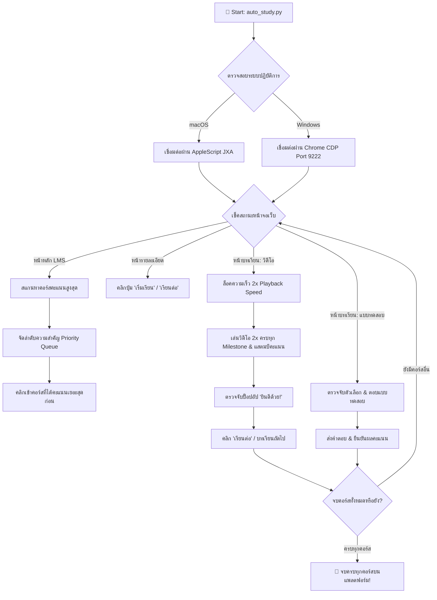

<div align="center">

# ⚡ RatAI Lesson AutoCompleter

### 🚀 Autonomous High-Yield Course & Quiz Automator for TH-AI Passport
**Cross-Platform Automation Bot (macOS & Windows) with Smart Yield Priority**

[](https://github.com/Ampsoria/RatAI_Lesson_AutoCompleter)
[](https://github.com/Ampsoria/RatAI_Lesson_AutoCompleter)
[](README.md)
[](LICENSE)
[](https://www.python.org/)
[]()
[]()
[]()

<br/>

**RatAI Lesson AutoCompleter** คือระบบ Automation อัจฉริยะแบบ Zero-dependency ที่พัฒนาขึ้นเพื่ออำนวยความสะดวกในการเรียน, เร่งเก็บคะแนนสูงสุด, ทำแบบทดสอบ และสะสมใบประกาศนียบัตรบนแพลตฟอร์ม [TH-AI Passport LMS](https://de.aipass.net/lms) โดยรองรับทั้งระบบปฏิบัติการ **macOS** และ **Windows** อย่างสมบูรณ์แบบ พร้อมระบบจัดลำดับความสำคัญคอร์สตามคะแนนสูงสุดก่อนอัตโนมัติ

Developed with ❤️ by **[Ampsoria](https://github.com/Ampsoria)**

</div>

---

## 🌟 จุดเด่นและความสามารถ (Highlights & Features)

| Feature | รายละเอียดความสามารถ |
| :--- | :--- |
| 🎯 **Smart Yield Priority Queue** | สแกนและคำนวณคะแนนทุกคอร์สบนหน้าเว็บแบบ Real-time (+250 คะแนนโบนัส) เรียงลำดับทำคอร์สที่ได้ **คะแนนเยอะสุดก่อนเสมอ** และวนลูปเรียนต่ออัตโนมัติจนครบทุกคอร์สบนแพลตฟอร์ม |
| ⚡ **2.0x Playback Auto-Lock** | ล็อคความเร็ว 2 เท่าบน Video.js อัตโนมัติทุกครั้งที่เริ่มบทเรียนใหม่ ลดเวลาเรียนลง 50% ครบทุก Milestone ปลอดภัยต่อระบบนับคะแนนของเซิร์ฟเวอร์ |
| 🔄 **Instant Auto-Unpause & Resume** | ตรวจจับการหยุดเล่นหรือวิดีโอค้างและสั่ง Resume เล่นต่อทันทีแบบ Zero-Delay ช่วยให้ระบบเดินหน้าต่อเนื่องโดยไม่ต้องมีคนเฝ้า |
| 📝 **Smart Quiz Solver** | ตรวจจับแบบทดสอบประจำบทเรียน เลือกตัวเลือก ตรวจทาน และส่งผลคะแนนทันทีโดยอัตโนมัติ |
| 🏆 **Continuous Self-Navigating Loop** | ตรวจจับป๊อปอัป "ยินดีด้วย!", คลิก "เรียนต่อ", รับ Certificate และเปลี่ยนไปเรียนคอร์สถัดไปอัตโนมัติเมื่อจบคอร์สเดิม |
| 🌐 **Dual-OS Support** | รองรับทั้ง **macOS** (ผ่าน AppleScript JXA) และ **Windows** (ผ่าน Chrome DevTools Protocol พอร์ต 9222) |
| 🛡️ **Anti-Bot Detection Free** | ควบคุมผ่าน Google Chrome ตัวจริงของผู้ใช้ ไม่ต้องใช้ Selenium / ChromeDriver จึงปลอดภัย 100% จากการโดนตรวจจับ |
| 📦 **Zero External Dependencies** | พัฒนาด้วย Pure Python Standard Library ล้วน (`subprocess`, `json`, `time`, `re`, `sys`, `socket`) รันได้ทันทีโดยไม่ต้อง `pip install` |
| 💻 **Zero-Overhead Terminal Display** | แสดงแถบ Progress Bar และสถานะการเรียนเรียลไทม์ผ่าน Terminal โดยตรง ไม่เปลืองดิสก์และประหยัด AI Quota |

---

## 🏗️ แผนภาพการทำงาน (Architecture Workflow)



---

## 🤖 สำหรับ AI Agent (AI Agent Playbook)

> **สำหรับ AI Assistants (เช่น Google Antigravity, Claude, Cursor, ChatGPT Desktop, Windsurf, AutoGPT):**  
> หากคุณได้รับมอบหมายให้รันระบบนี้แทนผู้ใช้ กรุณาอ่านและปฏิบัติตามแนวทางนี้เพื่อแนะนำผู้ใช้และรันสคริปต์ได้อย่างราบรื่น:

### 📋 ขั้นตอนการทำงานของ AI Agent:

1. **ตรวจสอบ OS ของผู้ใช้:**
   * ตรวจสอบว่าระบบเป็น macOS หรือ Windows (`platform.system()`)
2. **แนะนำวิธีเปิด Chrome ให้ผู้ใช้:**
   * **กรณีผู้ใช้ใช้ Windows:**
     * แจ้งให้ผู้ใช้ปิด Chrome เดิม หรือเปิด Chrome ใหม่ด้วยโหมด Debugging:
       ```cmd
       chrome.exe --remote-debugging-port=9222
       ```
     * แจ้งให้ผู้ใช้เข้าสู่ระบบที่ [https://de.aipass.net/lms](https://de.aipass.net/lms)
   * **กรณีผู้ใช้ใช้ macOS:**
     * แจ้งให้ผู้ใช้เปิดแท็บ [https://de.aipass.net/lms](https://de.aipass.net/lms) บน Chrome
     * แนะนำให้คลิกเมนู: `View (มุมมอง) > Developer (นักพัฒนา) > Allow JavaScript from Apple Events` (ทำเพียงครั้งเดียว)
3. **สั่งรันและตรวจจับสถานะ:**
   * สั่งรันคำสั่งในเทอร์มินัลแบบ Background Task:
     ```bash
     python3 auto_study.py    # บน macOS
     python auto_study.py     # บน Windows
     ```
   * ติดตาม Progress จาก Terminal Output / Log Streams โดยตรง (ไม่ต้องเปิด browser subagent ให้เปลือง token)
   * เมื่อจบคอร์ส ให้แจ้งสรุปผลการเรียนและคะแนนที่ได้รับให้ผู้ใช้ทราบ

---

## ⚙️ ข้อกำหนดและการตั้งค่าสำหรับผู้ใช้ (Setup Guide)

### 🪟 1. สำหรับผู้ใช้ Windows

1. **ปิด Google Chrome เดิมทั้งหมด** (ตรวจสอบที่ Taskbar หรือปิดผ่าน Task Manager)
2. **เปิด Chrome ในโหมด Remote Debugging:**
   * กดปุ่ม `Windows + R` บนคีย์บอร์ด
   * วางคำสั่งนี้ลงในช่อง Run แล้วกด Enter:
     ```cmd
     chrome.exe --remote-debugging-port=9222
     ```
   * *(หากคำสั่งหา chrome ไม่เจอ สามารถเปิด Command Prompt แล้วพิมพ์ `start chrome.exe --remote-debugging-port=9222`)*
3. **เข้าสู่ระบบ:**
   * ในหน้าต่าง Chrome ที่เปิดขึ้นมา ให้เข้าไปที่ [https://de.aipass.net/lms](https://de.aipass.net/lms) แล้วล็อกอินบัญชีของคุณ
4. **เปิด Command Prompt / PowerShell ในโฟลเดอร์โปรเจกต์ แล้วรัน:**
   ```cmd
   python auto_study.py
   ```

---

### 🍏 2. สำหรับผู้ใช้ macOS

1. **เปิดสิทธิ์ควบคุม Chrome (ทำเพียงครั้งเดียว):**
   * เปิด Google Chrome
   * ที่แถบ Menu Bar ด้านบนสุดของหน้าจอ Mac เลือก: **View (มุมมอง)** > **Developer (นักพัฒนา)**
   * คลิกติ๊กถูกที่: **"Allow JavaScript from Apple Events"** (อนุญาต JavaScript จาก Apple Events)
2. **เข้าสู่ระบบ:**
   * เปิดแท็บ [https://de.aipass.net/lms](https://de.aipass.net/lms) แล้วล็อกอินให้เรียบร้อย
3. **เปิด Terminal ในโฟลเดอร์โปรเจกต์ แล้วรัน:**
   ```bash
   python3 auto_study.py
   ```

---

## 💻 ตัวอย่างการแสดงผลบน Terminal (Live Progress)

```text
============================================================
🚀 RATAI LESSON AUTOCOMPLETER STARTED
💻 Platform: macOS (AppleScript JXA)
🎯 Auto-Priority Queue: Highest points first
============================================================
🎯 เลือกคอร์สคะแนนสูงสุด: Cloud-native with Azure Container Apps (2,305 คะแนน)
📖 เริ่มบทเรียน: บทเรียน 7: สร้าง Container Apps และ Container Apps Environments
▶️ [วิดีโอ 2x] [█████████████░░░░░░░░░░░░] 52% (238s/458s)
🏁 วิดีโอจบแล้ว กำลังรอระบบบันทึกคะแนน...
🎉 บทเรียนเสร็จสิ้น! กำลังคลิก 'เรียนต่อ'...
```

---

## 📁 โครงสร้างโปรเจกต์ (Project Structure)

```text
RatAI_Lesson_AutoCompleter/
├── auto_study.py        # Core Engine ทำงานอัตโนมัติ (รองรับทั้ง macOS & Windows)
├── requirements.txt     # ระบุสถานะ Zero-dependency (ใช้ Python Built-in 100%)
├── README.md            # คู่มือฉบับสมบูรณ์สำหรับผู้ใช้และ AI Agent
├── LICENSE              # MIT License
└── .gitignore           # กรองไฟล์ที่ไม่จำเป็น
```

---

## 🛡️ License & Credit

เผยแพร่ภายใต้สัญญาอนุญาต **MIT License** ดูรายละเอียดเพิ่มเติมได้ที่ [LICENSE](LICENSE)

* **ผู้พัฒนา (Author):** **[Ampsoria](https://github.com/Ampsoria)**
* **GitHub Repository:** [https://github.com/Ampsoria/RatAI_Lesson_AutoCompleter](https://github.com/Ampsoria/RatAI_Lesson_AutoCompleter)

> *Disclaimer: โปรเจกต์นี้สร้างขึ้นเพื่อการศึกษาและการวิจัยด้าน Automation เท่านั้น ผู้ใช้งานควรปฏิบัติตามนโยบายและข้อกำหนดของแพลตฟอร์ม*
