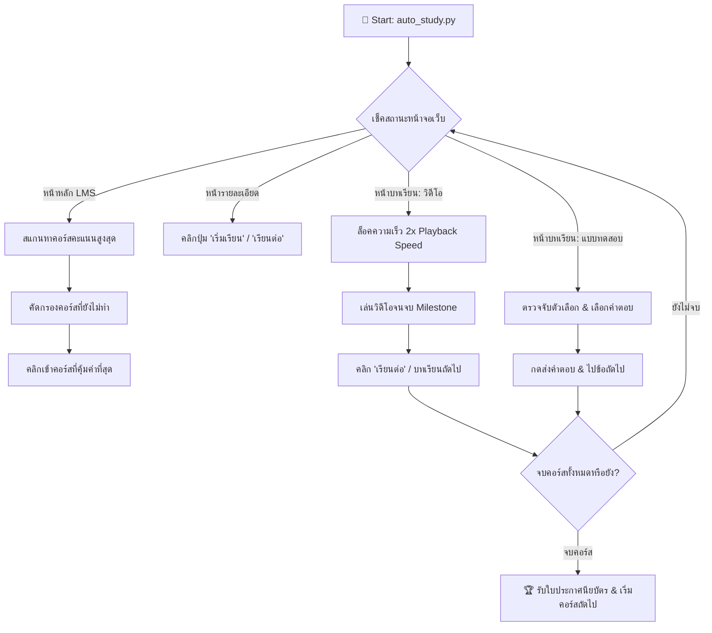

<div align="center">

# ⚡ RatAI Lesson AutoCompleter

### 🚀 Autonomous High-Yield Course & Quiz Automator for TH-AI Passport

[](https://github.com/Ampsoria/RatAI_Lesson_AutoCompleter)
[](https://github.com/Ampsoria/RatAI_Lesson_AutoCompleter)
[](LICENSE)
[](https://www.python.org/)
[]()
[]()

<br/>

**RatAI Lesson AutoCompleter** is an ultra-fast, zero-dependency autonomous bot designed to automate learning, maximize points, and clear certifications on [TH-AI Passport LMS](https://de.aipass.net/lms).

Developed with ❤️ by **[Ampsoria](https://github.com/Ampsoria)**

</div>

---

## 🌟 จุดเด่นและความสามารถ (Highlights & Features)

| Feature | รายละเอียดความสามารถ |
| :--- | :--- |
| 🎯 **Smart Yield Priority** | สแกนและคำนวณคะแนนทุกคอร์สแบบ Real-time (+250 คะแนนโบนัส) เรียงลำดับทำคอร์สที่ได้คะแนนสูงสุดก่อนเสมอ |
| ⚡ **2x Playback Auto-Lock** | ปรับความเร็ว 2 เท่าบน Video.js อัตโนมัติทุกครั้งที่เริ่มบทเรียนใหม่ ลดเวลาเรียนลง 50% อย่างถูกต้องตามเงื่อนไขเซิร์ฟเวอร์ |
| 📝 **Smart Quiz Solver** | ตรวจจับแบบทดสอบประจำบทเรียน เลือกตัวเลือก ตรวจทาน และส่งผลคะแนนทันทีโดยไม่ต้องคลิกเอง |
| 🔄 **Self-Navigating Loop** | ตรวจจับป๊อปอัป "ยินดีด้วย!", กด "เรียนต่อ", รับ Certificate และเปลี่ยนคอร์สอัตโนมัติเมื่อเรียนจบ |
| 🛡️ **Anti-Bot Detection Free** | ควบคุมผ่าน AppleScript JavaScript for Automation (JXA) จึงใช้ Session/Cookies จริง ปลอดภัย ไม่โดนตรวจจับ |
| 📦 **Zero Dependencies** | รันด้วย Pure Python Standard Library (`subprocess`, `json`, `time`, `re`, `sys`) รันได้ทันทีทุกเครื่อง |

---

## 🏗️ แผนภาพการทำงาน (Architecture Workflow)



---

## ⚙️ ข้อกำหนดเบื้องต้น (Prerequisites)

1. **ระบบปฏิบัติการ:** macOS (Catalina, Big Sur, Monterey, Ventura, Sonoma, Sequoia หรือใหม่กว่า)
2. **เบราว์เซอร์:** Google Chrome
3. **การเปิดสิทธิ์ควบคุม Chrome (ตั้งค่าเพียงครั้งเดียว):**
   * เปิด Google Chrome
   * ที่ Menu Bar ด้านบนของเครื่อง Mac เลือก: **View (มุมมอง)** > **Developer (นักพัฒนา)**
   * คลิกติ๊กถูกที่: **"Allow JavaScript from Apple Events"** (อนุญาต JavaScript จาก Apple Events)
4. **เข้าสู่ระบบ:**
   * ล็อกอินบัญชีของคุณใน [https://de.aipass.net/lms](https://de.aipass.net/lms) บน Chrome ทิ้งไว้ 1 แท็บ

---

## 🚀 วิธีการติดตั้งและเริ่มใช้งาน (Getting Started)

### 1. Clone Repository

```bash
git clone https://github.com/Ampsoria/RatAI_Lesson_AutoCompleter.git
cd RatAI_Lesson_AutoCompleter
```

### 2. รันสคริปต์

```bash
python3 auto_study.py
```

### 3. ตัวอย่างการแสดงผลบน Terminal (Live Progress)

```text
============================================================
🚀 RATAI LESSON AUTOCOMPLETER STARTED
============================================================
🎯 คัดเลือกคอร์สคะแนนสูงสุด: Cloud-native with Azure Container Apps (2,055 คะแนน)
📖 อยู่ในหน้ารายละเอียดคอร์ส กำลังคลิกเริ่มเรียน...
▶️ [วิดีโอ 2x] [██████████████████░░░░░░░] 74% (702s/948s)
🏁 วิดีโอจบแล้ว กำลังรอระบบบันทึกคะแนน...
🎉 บทเรียนเสร็จสิ้น! กำลังคลิก 'เรียนต่อ'...
```

---

## 🤖 สำหรับ AI Agents & Automation Frameworks

หากคุณเป็น **AI Coding Assistant / Subagent** (เช่น Google Antigravity, Claude Desktop, Cursor, AutoGPT) ที่ต้องการนำสคริปต์นี้ไปทำงานแทนผู้ใช้:

1. **Test Connection:**
   ```bash
   osascript -l JavaScript -e 'Application("Google Chrome").windows[0].activeTab.execute({javascript: "document.title"})'
   ```
2. **Execute as Background Daemon:**
   ```bash
   python3 auto_study.py
   ```
3. **Inspect Logs:**  
   ตรวจสอบความคืบหน้าผ่าน standard output หรือ log streams โดยไม่ต้องเปลือง Token ในการจับภาพหน้าจอหรือเปิด browser subagent ซ้ำซ้อน

---

## 📁 โครงสร้างโปรเจกต์ (Project Tree)

```text
RatAI_Lesson_AutoCompleter/
├── auto_study.py        # Core Engine: ระบบควบคุมและวนลูปคอร์สอัตโนมัติ
├── requirements.txt     # เอกสารระบุ Zero-dependency
├── README.md            # คู่มือการใช้งานฉบับสมบูรณ์
├── LICENSE              # MIT License
└── .gitignore           # กรองไฟล์แคชและไฟล์ระบบ
```

---

## 🛡️ License & Credit

เผยแพร่ภายใต้สัญญาอนุญาต **MIT License** ดูรายละเอียดเพิ่มเติมได้ที่ [LICENSE](LICENSE)

* **ผู้พัฒนา (Author):** **[Ampsoria](https://github.com/Ampsoria)**
* **GitHub Repository:** [https://github.com/Ampsoria/RatAI_Lesson_AutoCompleter](https://github.com/Ampsoria/RatAI_Lesson_AutoCompleter)

> *Disclaimer: โปรเจกต์นี้สร้างขึ้นเพื่อการศึกษาและการวิจัยด้าน Browser Automation เท่านั้น ผู้ใช้งานควรปฏิบัติตามข้อกำหนดและนโยบายการใช้งานของแพลตฟอร์ม*
